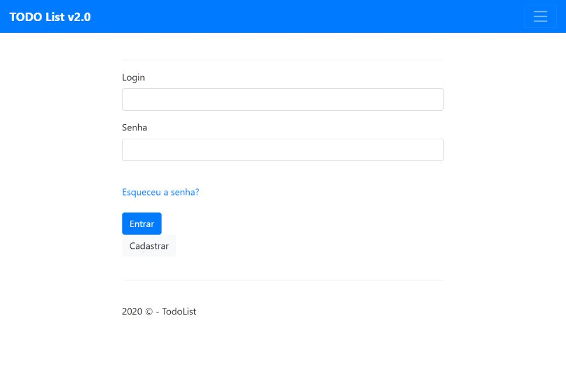

# Todo List Gestão de Tarefas em Java

Aplicação web de gerenciamento de tarefas com páginas renderizadas no servidor, autenticação e associação de tarefas a usuários. O repositório reúne o backend Spring e a interface Thymeleaf da mesma aplicação.

**Categoria:** Aplicação web · Frontend embarcado · Gestão de tarefas.

## Tecnologias principais

- Java 11
- Spring Boot 2.3.2
- Thymeleaf
- Spring Security
- Spring Data JPA
- PostgreSQL

## Funcionalidades presentes no código

- Página de login com autenticação pelo Spring Security.
- Listagem de tarefas e consulta dos seus detalhes.
- Formulário de criação e página de edição de tarefa.
- Associação entre tarefas, usuários e compartilhamentos.
- Cadastro e consulta de usuários.
- Perfis de usuário e administrador representados por roles.

Os modelos incluem nome, descrição, data e estado de conclusão da tarefa. `DummyData` cria usuários, roles, tarefas e associações de demonstração na inicialização.

## Interface e arquitetura

As páginas ficam em `src/main/resources/templates/`. Os controladores entregam modelos e views, em vez de fornecer apenas uma API JSON. A interface é renderizada com Thymeleaf e utiliza Bootstrap nos componentes visuais.

| Camada | Responsabilidade |
| --- | --- |
| `controller/` | Rotas das páginas e recebimento dos formulários. |
| `service/` | Operações sobre tarefas, usuários e compartilhamentos. |
| `repository/` | Persistência das entidades. |
| `configuration/security/` | Autenticação e autorização. |

Entre as rotas estão `/login`, `/tarefas`, `/tarefas/{id}`, `/novatarefa`, `/editartarefa/{id}`, `/usuarios` e `/novousuario`.

## Executar

Configure um banco PostgreSQL local e ajuste a conexão em `src/main/resources/application.properties`. Use JDK 11 e o Maven Wrapper:

```bash
./mvnw spring-boot:run
```

No Windows, use `mvnw.cmd spring-boot:run`. Abra `http://localhost:8080/login`.

A configuração original utiliza `ddl-auto=create-drop`, apropriada para demonstração, e recria as tabelas. Use um banco separado dos seus dados de uso cotidiano.

## Execução das capturas e limitações observadas

A aplicação foi compilada e a página de login foi renderizada pelo backend na porta 8086. H2 foi adicionado somente à cópia local para executar sem um servidor PostgreSQL. Essa alteração não faz parte da documentação publicada.

A senha dos usuários BCrypt de demonstração não foi confirmada na coleta. O link “Cadastrar” da tela aponta para `/UsuarioForm`, enquanto o controlador implementa `/novousuario`; o acesso retornou à página de login. Por isso, a captura comprova a execução da interface inicial, e não a conclusão do fluxo autenticado de tarefas.

## Relação com outros projetos

Este repositório contém sua própria interface. Não depende de `todo_list_flutter_app`: os dois projetos usam tecnologias e persistências diferentes.

## Capturas do sistema

Capturas reais obtidas em execução local em 12/10/2026.

### Página inicial



## Histórico

Repositório criado no GitHub em **2020-08-10**. Essa data identifica a criação do repositório; não comprova o início nem a conclusão do desenvolvimento.
